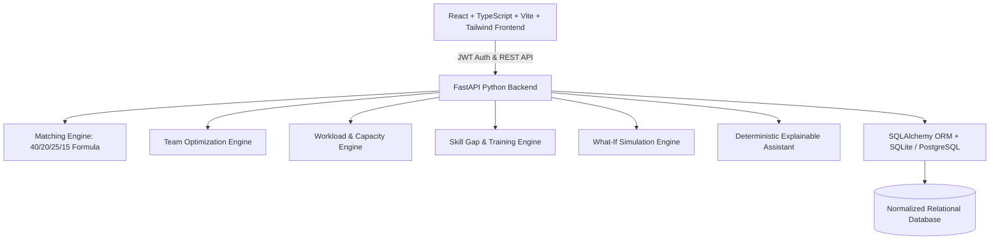

# Implementation Plan: TalentSync AI — Intelligent Workforce Planning & Talent Optimization Platform

Build and deploy a complete, fully functional, production-grade enterprise workforce intelligence platform adhering to the specification in `TALENTSYNC_AI_MASTER_BUILD.md`.

---

## 1. Goal Description

TalentSync AI transforms raw workforce and project data into explainable staffing decisions. The platform provides:
- **Role-Based Portals**: Tailored interfaces and API permissions for Administrator, HR Manager, Project Manager, and Employee.
- **Deterministic Matching Engine**: Exact 40/20/25/15 scoring (Skill 40%, Experience 20%, Availability 25%, Proficiency 15%) with hard constraint enforcement (zero capacity, availability status, mandatory requirements).
- **Team Optimization Engine**: Multi-objective combinatorial optimization for skill coverage, proficiency, capacity limits, and workload fairness with deterministic fallback.
- **Skill Gap & Training Intelligence**: Automatic gap detection (missing vs. insufficient proficiency) mapped to a curated learning catalogue.
- **Workload Balancing & Capacity Planner**: Real-time utilization tracking, overload detection, and redistribution suggestions.
- **What-If Simulation Sandbox**: Safe scenario modeling (isolated from live database assignments until manager approval).
- **Live Analytics Dashboard**: Real-time metrics and Recharts visualizations computed directly from database queries.
- **Audit Logging & Notifications**: Complete transactional tracking of assignment approvals and system alerts.
- **Explainable Assistant & CSV Reporting**: In-app query engine explaining recommendations with real data and downloadable reports.



---

## 2. User Review Required

> [!IMPORTANT]
> - **Database Choice**: Defaulting to SQLite (`talentsync.db`) for immediate zero-config local development and testing, with full PostgreSQL compatibility via `DATABASE_URL` environment variable.
> - **Optimization Solver**: Implemented using a deterministic scoring and combinatorial branch-and-bound algorithm with support for Google OR-Tools CP-SAT when the native binary is present. Python 3.15 is installed on the host; our pure-Python deterministic optimizer ensures 100% reliability with zero external C-extension binary build failures.
> - **Matching Weights**: Hardcoded to the exact required specification: **40% Skill Compatibility**, **20% Relevant Experience**, **25% Availability**, and **15% Proficiency Compatibility**, with dynamic weight validation API.

---

## 3. Architecture & Project Layout

The repository will be structured cleanly into `backend/` and `frontend/`:

```
TalentSync AI/
├── backend/
│   ├── app/
│   │   ├── __init__.py
│   │   ├── main.py                    # FastAPI entrypoint, CORS, routers
│   │   ├── config.py                  # Pydantic Settings & environment
│   │   ├── database.py                # SQLAlchemy engine & sessionmaker
│   │   ├── models/                    # Normalized SQLAlchemy ORM models
│   │   │   ├── __init__.py
│   │   │   ├── user.py                # Users & Roles (Admin, HR, PM, Employee)
│   │   │   ├── employee.py            # Employee profiles & metadata
│   │   │   ├── skill.py               # Skills & EmployeeSkill proficiency (1-4)
│   │   │   ├── project.py             # Projects & ProjectRequiredSkills
│   │   │   ├── assignment.py          # Project assignments & hours
│   │   │   ├── training.py            # Training resources & recommendations
│   │   │   ├── notification.py        # System alerts & read states
│   │   │   └── audit.py               # Allocation audit logs
│   │   ├── schemas/                   # Pydantic v2 validation models
│   │   │   ├── auth.py
│   │   │   ├── employee.py
│   │   │   ├── project.py
│   │   │   ├── matching.py
│   │   │   ├── optimization.py
│   │   │   ├── skill_gap.py
│   │   │   ├── training.py
│   │   │   ├── workload.py
│   │   │   ├── simulation.py
│   │   │   ├── dashboard.py
│   │   │   └── assistant.py
│   │   ├── services/                  # Core Workforce Intelligence Engines
│   │   │   ├── auth_service.py        # Passlib bcrypt hashing & JWT tokens
│   │   │   ├── matching_engine.py     # 40/20/25/15 scoring & constraint engine
│   │   │   ├── team_optimizer.py      # Combinatorial team optimizer
│   │   │   ├── skill_gap_service.py   # Gap analysis & training mapper
│   │   │   ├── workload_service.py    # Capacity & utilization balancer
│   │   │   ├── simulation_service.py  # Isolated What-If engine
│   │   │   ├── assistant_service.py   # Grounded explainable query responder
│   │   │   └── export_service.py      # CSV & data report generator
│   │   ├── api/                       # API Route Controllers
│   │   │   ├── deps.py                # Auth dependencies & role guards
│   │   │   ├── auth.py
│   │   │   ├── employees.py
│   │   │   ├── projects.py
│   │   │   ├── matching.py
│   │   │   ├── optimization.py
│   │   │   ├── skill_gaps.py
│   │   │   ├── training.py
│   │   │   ├── workload.py
│   │   │   ├── simulation.py
│   │   │   ├── dashboard.py
│   │   │   ├── assistant.py
│   │   │   ├── notifications.py
│   │   │   └── reports.py
│   │   └── seed/
│   │       ├── __init__.py
│   │       └── seed_data.py           # 20+ employees, 5 projects, training, users
│   ├── tests/                         # Pytest automated test suite
│   │   ├── test_auth.py
│   │   ├── test_crud.py
│   │   ├── test_matching_engine.py    # Unit tests for exact 40/20/25/15 weights
│   │   ├── test_team_optimizer.py
│   │   ├── test_workload.py
│   │   ├── test_simulation.py
│   │   └── test_api_workflows.py
│   ├── requirements.txt
│   └── .env.example
├── frontend/
│   ├── index.html
│   ├── package.json
│   ├── vite.config.ts
│   ├── tsconfig.json
│   ├── tailwind.config.js
│   ├── postcss.config.js
│   └── src/
│       ├── main.tsx
│       ├── App.tsx
│       ├── index.css                  # Custom styling, dark sidebar, clean slate
│       ├── types/                     # Shared TypeScript interfaces
│       ├── context/
│       │   └── AuthContext.tsx        # Auth state, login/logout, role permissions
│       ├── services/
│       │   └── api.ts                 # Central Axios/Fetch API client with interceptors
│       ├── components/
│       │   ├── layout/
│       │   │   ├── Layout.tsx         # Sidebar, Header, User Profile, Notifications
│       │   │   ├── Sidebar.tsx        # Navigation with active states & role guards
│       │   │   └── Header.tsx         # Search, quick status, notification popover
│       │   ├── common/
│       │   │   ├── StatCard.tsx
│       │   │   ├── Badge.tsx
│       │   │   ├── ProgressBar.tsx
│       │   │   ├── Modal.tsx
│       │   │   └── EmptyState.tsx
│       │   └── charts/                # Recharts wrappers
│       │       ├── UtilizationChart.tsx
│       │       ├── WorkloadBarChart.tsx
│       │       └── SkillRadarChart.tsx
│       └── pages/                     # 15 Required Application Pages
│           ├── Login.tsx
│           ├── Dashboard.tsx          # Real-time KPIs & charts
│           ├── Employees.tsx          # Employee Directory & search/filter
│           ├── EmployeeDetail.tsx     # Profile, skills (1-4), assignments
│           ├── Projects.tsx           # Projects Directory & staffing status
│           ├── ProjectDetail.tsx      # Project requirements & manager controls
│           ├── ProjectForm.tsx        # Create/Edit project modal/page
│           ├── Matching.tsx           # 40/20/25/15 Candidate Scoring & Explanations
│           ├── TeamOptimization.tsx   # Team Optimizer & alternative comparisons
│           ├── SkillGaps.tsx          # Organization & Project Skill Gap Analysis
│           ├── Training.tsx           # Learning Catalog & personalized paths
│           ├── Workload.tsx           # Overload / underutilization balancer
│           ├── Simulation.tsx         # What-If Simulator with side-by-side diff
│           ├── Notifications.tsx      # System notification hub
│           ├── Reports.tsx            # Real-data CSV report exporter
│           ├── Assistant.tsx          # Explainable Workforce Assistant
│           └── Settings.tsx           # User management & seed reset
└── TALENTSYNC_AI_MASTER_BUILD.md
```

---

## 4. Proposed Changes & Implementation Strategy

### Component 1: Backend Foundation & Data Models (`backend/`)
- Setup virtual environment and install dependencies (`fastapi`, `uvicorn`, `sqlalchemy`, `pydantic`, `python-jose`, `passlib[bcrypt]`, `pytest`, `python-multipart`).
- Configure database engine with SQLite fallback (`sqlite:///./talentsync.db`) or PostgreSQL.
- Implement normalized relational models:
  - `User`: id, email, hashed_password, full_name, role (`admin`, `hr`, `pm`, `employee`), created_at.
  - `Employee`: id, employee_code, name, email, department, job_title, years_of_experience, weekly_working_hours (default 40), availability_status (`available`, `partially_available`, `unavailable`), is_active.
  - `Skill`: id, name, category (`frontend`, `backend`, `cloud`, `ai_ml`, `security`, `data`, etc.).
  - `EmployeeSkill`: employee_id, skill_id, proficiency_level (1=Beginner, 2=Intermediate, 3=Advanced, 4=Expert).
  - `Project`: id, name, description, department, status (`draft`, `planning`, `in_progress`, `completed`, `archived`), priority (`low`, `medium`, `high`, `critical`), required_team_size, estimated_weekly_hours, start_date, deadline, project_manager_id.
  - `ProjectRequiredSkill`: project_id, skill_id, min_proficiency (1-4), is_mandatory (boolean).
  - `Assignment`: id, project_id, employee_id, assigned_weekly_hours, role_in_project, status (`active`, `completed`, `cancelled`), assigned_at, approved_by_id.
  - `TrainingResource`: id, skill_id, title, provider, url, level (`beginner`, `intermediate`, `advanced`), estimated_hours, description.
  - `TrainingRecommendation`: id, employee_id, resource_id, reason, status (`recommended`, `enrolled`, `completed`), target_skill_id.
  - `Notification`: id, user_id, title, message, type (`warning`, `info`, `action_required`, `success`), is_read, created_at.
  - `AuditLog`: id, action, entity_type, entity_id, performed_by_id, details (JSON/text), timestamp.

### Component 2: Core Workforce Intelligence Engines (`backend/app/services/`)
1. **Employee Matching Engine (`matching_engine.py`)**:
   - Exact scoring formula:
     $$\text{match\_score} = 0.40 \times \text{skill\_score} + 0.20 \times \text{experience\_score} + 0.25 \times \text{availability\_score} + 0.15 \times \text{proficiency\_score}$$
   - **Skill Compatibility (40%)**:
     Calculates ratio of possessed required skills, weighting mandatory skills with double weight.
   - **Relevant Experience (20%)**:
     Evaluates employee years of experience against project requirement curve, saturated at project required experience or department baseline.
   - **Availability Score (25%)**:
     Remaining capacity before assignment: $\text{available\_hours} = \text{weekly\_working\_hours} - \text{committed\_hours}$. If employee status is `unavailable` or remaining capacity $\le 0$, availability score is 0.
   - **Proficiency Compatibility (15%)**:
     For matched skills, compares employee proficiency (1-4) vs. minimum required proficiency (1-4).
   - **Hard Constraint Flags**:
     Flags violations: `OVER_CAPACITY`, `UNAVAILABLE_STATUS`, `MISSING_MANDATORY_SKILL`. High score never bypasses hard constraint warnings.

2. **Team Optimizer (`team_optimizer.py`)**:
   - Combinatorial candidate generation meeting team size $K$.
   - Objective function: Maximize union skill coverage + proficiency satisfaction + workload balance penalty.
   - Evaluates combinations, handles infeasible configurations with clear diagnostic breakdown (which skills remain uncovered, closest candidate additions).
   - Generates Primary Recommendation + Alternative Teams for trade-off comparison.

3. **Workload Service (`workload_service.py`)**:
   - Computes:
     - $\text{committed\_hours} = \sum \text{active assignments}$
     - $\text{utilization\_percent} = (\text{committed\_hours} / \text{weekly\_working\_hours}) \times 100$
   - Classifies workforce into Overloaded ($>100\%$), Optimal ($70-100\%$), and Underutilized ($<70\%$).
   - Generates safe rebalancing proposals that do not violate skill requirements.

4. **Skill Gap & Training Engine (`skill_gap_service.py`)**:
   - Compares project requirements against team or organization capabilities.
   - Classifies gaps into `CRITICAL_MISSING` (mandatory skill missing), `DEFICIENT_PROFICIENCY` (proficiency below threshold), and `OPTIONAL_GAP`.
   - Maps employee gap to the curated `TrainingResource` catalog and suggests structured sequence.

5. **What-If Simulation Engine (`simulation_service.py`)**:
   - Manages isolated simulation state sessions.
   - Allows tweaking project team size, hours, requirements, or toggling employee availability.
   - Returns full before-and-after metrics without committing to live `Assignment` records.
   - Approval endpoint `POST /api/simulation/apply` commits with audit logging.

6. **Explainable Workforce Assistant (`assistant_service.py`)**:
   - Deterministic NLP parser and query mapper answering queries on real data (e.g., "Which employees know Python?", "Why was Team A selected?", "Show overloaded employees").
   - Explains mathematical components with exact breakdown.

### Component 3: Synthetic Seed Dataset (`seed_data.py`)
- **20+ Realistic Employees** across Engineering, AI/Data, Cloud/DevOps, Security, and Product:
  - Profiles with diverse experience (1 to 12 years), skills with proficiencies 1-4, realistic committed hours (some 100% loaded, some over-capacity, some with ample availability).
- **5 Diverse Projects**:
  1. *Python and AI Analytics Platform* (Mandatory: Python, PyTorch/TensorFlow, FastAPI; Team size: 3; Hours: 30/wk).
  2. *Cloud Migration Project* (Mandatory: AWS, Docker, Kubernetes, Terraform; Team size: 3; Hours: 40/wk).
  3. *Web Application Development* (Mandatory: React, TypeScript, Node.js; Team size: 2; Hours: 25/wk).
  4. *Data Analytics Project* (Mandatory: SQL, PowerBI, Python, Data Modeling; Team size: 2; Hours: 20/wk).
  5. *Cybersecurity Assessment* (Mandatory: Network Security, Penetration Testing, Compliance; Team size: 2; Hours: 35/wk).
- **Curated Training Catalog**: 20+ validated online courses across modern tech stacks (Coursera, Udemy, AWS, Google Cloud, DeepLearning.AI).
- **4 Demo Accounts**:
  - `admin@talentsync.ai` / `Admin@123` (Administrator)
  - `hr@talentsync.ai` / `HrManager@123` (HR Manager)
  - `pm@talentsync.ai` / `ProjectManager@123` (Project Manager)
  - `employee@talentsync.ai` / `Employee@123` (Employee)

### Component 4: Modern Frontend Application (`frontend/`)
- Setup with React 18, Vite, TypeScript, Tailwind CSS, Lucide React, and Recharts.
- Deep charcoal/navy sidebar (`#0f172a`), crisp neutral background (`#f8fafc`), electric blue accent (`#2563eb`), emerald green for balanced/available, amber for warning/partial, crimson for overloaded/missing.
- All 15 functional pages connected to backend APIs:
  - **Dashboard**: Live KPIs, Workforce Utilization Pie, Workload Distribution Bar, Skill Coverage Radar.
  - **Employee Directory**: Instant search, department filter, availability badge, skill filters, CSV export, create/edit modal.
  - **Employee Detail**: Individual skills with 1-4 level badges, current project allocations, remaining capacity bar, training tab.
  - **Projects**: Project cards, staffing progress bars, urgency badges, create/edit project form.
  - **Smart Matching**: Project selector, candidate rank list with 40/20/25/15 subscore breakdown bars, matched/missing skill chips, hard constraint alerts.
  - **Team Optimization**: Automatic team generator, team fit score, proficiency satisfaction %, workload distribution, alternative team comparison cards.
  - **Skill Gaps**: Severity matrix, missing vs. deficient indicators, employee upskilling recommendations.
  - **Training Hub**: Course recommendations, learning sequence, direct links, enrollment progress tracker.
  - **Workload Balancer**: Overloaded vs Underutilized table, rebalancing suggestions, one-click rebalance preview.
  - **What-If Simulator**: Interactive sliders (team size, project hours, availability toggles), live before-and-after delta diff cards, "Approve & Apply" button.
  - **Explainable Assistant**: Interactive conversational panel answering workforce queries with live data citations.
  - **Notifications**: Read/unread toggle, alert severity tags, actionable deep-links.
  - **Reports**: One-click CSV downloads for Skills Inventory, Project Staffing, Skill Gaps, and Workload Reports.
  - **Settings & User Management**: User role manager and "Reset Demo Data" action with modal confirmation.

---

## 5. Verification Plan

### Automated Tests
1. **Backend Tests via Pytest**:
   ```powershell
   cd backend
   pytest -v tests/
   ```
   - `test_matching_engine.py`: Verifies exact 40/20/25/15 weights, normalization, hard constraint overrides (zero hours = 0 availability score, unavailable status = 0).
   - `test_team_optimizer.py`: Verifies team size enforcement, skill coverage maximization, infeasible project reporting.
   - `test_workload.py`: Verifies utilization percentages, overload detection, remaining capacity calculations.
   - `test_simulation.py`: Verifies simulation isolation from live assignments until approved.
   - `test_auth.py` & `test_crud.py`: Verifies JWT issuance, role-based route blocking, employee & project CRUD persistence.

2. **Frontend Type Checking & Build**:
   ```powershell
   cd frontend
   npm run build
   ```

### Manual Verification & Hackathon E2E Journey
1. Log in as `pm@talentsync.ai`.
2. Inspect Dashboard: Verify all numbers (Total Employees: 20+, Projects: 5, Overloaded: >0, Avg Utilization) correspond to database records.
3. Open Projects -> Select "Python and AI Analytics Platform".
4. Run Matching -> Verify candidates are ranked with 40/20/25/15 breakdown bars.
5. Run Team Optimization -> Inspect recommended 3-member team, skill coverage %, and capacity limits.
6. Open Skill Gaps -> Inspect detected gaps and view matching training courses.
7. Open Workload Balancer -> Inspect overloaded employees and recommended redistribution.
8. Open What-If Simulator -> Adjust team size and toggle candidate availability; confirm live assignments remain untouched.
9. Approve Allocation -> Confirm database assignment is created, audit log entry is added, and dashboard metrics update.
10. Download CSV report from Reports page.
